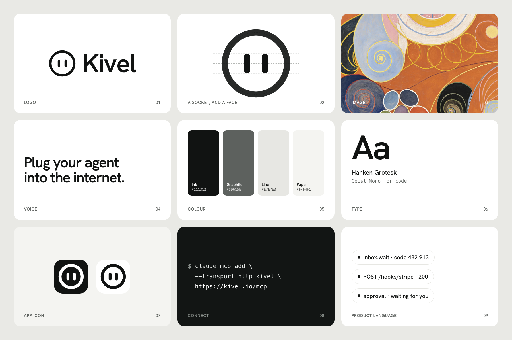

# Kivel brand kit

Kivel is the internet toolkit for coding agents: email inboxes, webhook URLs, mock APIs and 170 tools over one MCP connection. The brand is white, minimal and black and white, with one colourful painting.

## Logo

The mark is a wall socket whose two slots read as eyes: it plugs your agent into the internet and has a bit of a face. On the site the eyes follow the pointer.

| File | Use |
|---|---|
| `logo/kivel-logo-ink.svg` · `.png` | Mark and wordmark, on light backgrounds. Default. |
| `logo/kivel-logo-white.svg` · `.png` | Mark and wordmark, on dark backgrounds or photos. |
| `logo/kivel-mark-ink.svg` · `kivel-mark-white.svg` | Mark alone, where the name already appears nearby. |
| `logo/kivel-wordmark-ink.svg` · `kivel-wordmark-white.svg` | Name alone, for tight horizontal spaces. |
| `logo/kivel-icon-ink.svg` · `kivel-icon-ink-1024.png` | App icon and favicon: white mark on an ink tile. |
| `logo/kivel-icon-white.svg` | Ink mark on a white tile, for dark surroundings. |
| `logo/kivel-avatar-400.png` | Profile picture for GitHub, X, LinkedIn, npm, Discord and Product Hunt. |

The wordmark is Hanken Grotesk SemiBold, converted to outlines, so the SVGs render the same everywhere without the font installed.

**Rules**
- Clear space: keep at least half the mark's width empty around the logo.
- Minimum size: 20px tall on screen for the mark and wordmark, 16px for the mark alone.
- Use the logo in ink or white only. No colours, gradients, shadows or outlines.
- Don't stretch, rotate or redraw it, and don't put it on busy parts of the painting.
- Write the name as **Kivel** in text, and use **kivel.io** for the address.

## Colour

| Name | Hex | Use |
|---|---|---|
| Ink | `#111312` | Text, logo, buttons, code blocks |
| Graphite | `#5D615E` | Secondary text |
| Line | `#E7E7E3` | Borders and dividers |
| Paper | `#F4F4F1` | Quiet panels and backgrounds |
| White | `#FFFFFF` | Page background |

There is no accent colour. The only colour in the brand comes from the painting.

## Type

- **Hanken Grotesk** for everything: SemiBold (600) for headlines with tight tracking (−0.04em), Medium (500) and Regular (400) for text. Free on Google Fonts.
- **Geist Mono** for code, commands and URLs in code.

## Image

Hilma af Klint, *The Ten Largest, No. 3, Youth* (1907), public domain. Use one crop at a time, framed with rounded corners or bleeding off one edge, beside plenty of white. No other photos, illustrations or stock images.

## Voice

Short, plain and specific. Say what the agent can do, not how amazing it is.

- Headline: **The internet toolkit for your coding agent.**
- Line: **Plug your agent into the internet.**
- Description: Email, webhooks, mocks and 170 tools over one MCP connection.

## Banners

| File | Size | Where |
|---|---|---|
| `banners/kivel-og-1200x630.png` | 1200 × 630 | Link previews (the site generates its own from the same design) |
| `banners/kivel-github-social-1280x640.png` | 1280 × 640 | GitHub repo → Settings → Social preview |
| `banners/kivel-x-header-1500x500.png` | 1500 × 500 | X profile header |
| `banners/kivel-linkedin-banner-1584x396.png` | 1584 × 396 | LinkedIn page cover |
| `banners/kivel-post-1080x1080.png` | 1080 × 1080 | Square launch post for X, LinkedIn or Instagram |

The X and LinkedIn headers keep the left side empty because the profile picture covers the bottom left corner there.
